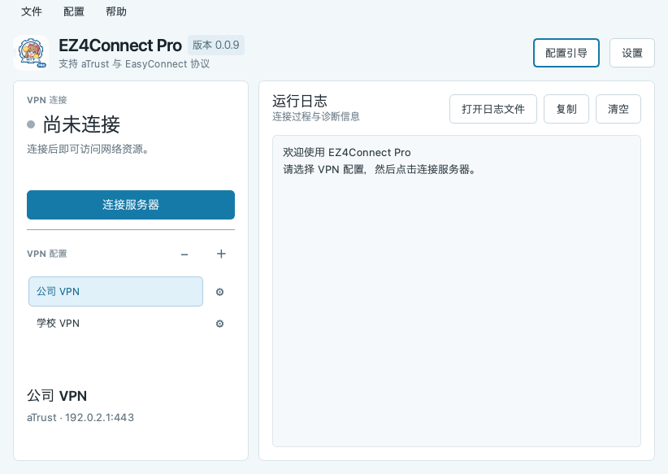

# EZ4Connect Pro

EZ4Connect Pro 基于 [EZ4Connect](https://github.com/chenx-dust/EZ4Connect)，增加了多 VPN 配置：每条配置独立保存服务器地址、端口、账号密码和认证方式。Pro 持续同步原版更新。



## 使用方式

从 [Releases](https://github.com/ffxgamer/EZ4Connect-pro/releases/latest) 下载适合系统和处理器架构的版本：

- **Windows**：下载 `windows-x64.zip` 或 `windows-arm64.zip`，解压后运行 `EZ4Connect.exe`。
- **macOS**：下载 `macos-arm64.dmg`（Apple 芯片）或 `macos-x64.dmg`（Intel 芯片），打开后将应用拖入「应用程序」。
- **Linux**：下载对应架构的 `.AppImage`，赋予执行权限后运行，例如 `chmod +x EZ4Connect-pro-*.AppImage`。

首次使用时，跟随配置引导填写服务器地址、账号和密码，或在「设置」中配置。选好配置后，点击「连接服务器」。如需使用系统代理，可在应用中启用「设置系统代理」。

### 多 VPN 配置

- 点击「VPN 配置」旁的 **＋**，新建一条配置并填写连接信息。
- 选中需要删除的配置，点击 **−** 并准确输入配置名称确认删除。默认配置不可删除；删除前请先断开 VPN。
- 点击配置旁的 **齿轮**，修改该配置的服务器和账号信息。
- 点击配置名称可选择配置；选择其他配置时，已有连接会保持。点击「连接服务器」后，才会断开原连接并连接所选配置。

### macOS 打开提示

当前 macOS 版本没有经过 Apple 开发者签名和公证，首次打开可能被系统阻止。确认应用从本项目的 Releases 下载后，先尝试打开应用，再进入「系统设置」→「隐私与安全性」，找到该应用并点击「仍要打开」；详细步骤参见 [Apple 支持](https://support.apple.com/zh-cn/102445)。

如果系统提示应用「已损坏」，请先重新从本项目的 Releases 下载并安装。确认下载来源可信且仍无法打开时，可以在「终端」中移除该应用的下载隔离标记，然后重新打开：

```bash
xattr -dr com.apple.quarantine "/Applications/EZ4Connect Pro.app"
```

### macOS 应用内更新

Apple 芯片版可通过主界面的「更新」检查、下载并安装后续版本。默认使用 `https://ghfast.top` 加速，也可以改为其他支持拼接 GitHub 链接的 HTTPS 代理，或留空直连；代理失败后会自动尝试直连。请只使用可信的代理。下载完成后会检查文件大小和 SHA-256，安装时自动移除隔离属性并重新启动，启动成功后显示提示。

更新前请先断开 VPN 和系统代理，并确保应用已安装在当前用户可写入的位置。安装包使用临时签名而未公证；下载校验用于检测文件损坏，不能替代开发者身份认证。0.0.7 及之前的版本没有应用内更新功能，需要手动安装本版本一次。

更多功能与高级用法请参阅 [原版项目](https://github.com/chenx-dust/EZ4Connect)。
